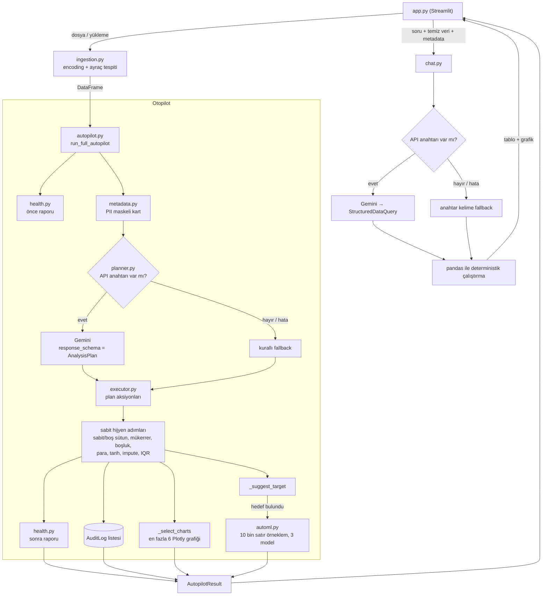

# Data Autopilot AI — Analiz ve Yol Haritası

**Tarih:** 10 Kasım 2026 · **Kapsam:** `app.py`, `core/` (9 modül, ~1.540 satır), `requirements.txt`, `.cursorrules`, `.github/`, `data/`

## Durum (ilk sprint sonrası)

Bu belge sprint öncesi durumu anlatır; aşağıdaki maddeler o tarihten sonra düzeltildi ve her biri regresyon testiyle korunuyor.

| Madde | Durum | Not |
|---|---|---|
| K1 — kimlik/metin sütunlarının sayıya çevrilmesi | ✅ Düzeltildi | `core/columns.py::parse_numeric_text`, tam eşleşme ve TR/ABD biçim tespiti |
| K2 — bölmeden önce doldurma ve IQR kırpma | ✅ Düzeltildi | Hijyenden çıkarıldı; aykırı değerler yalnızca raporlanıyor |
| K3 — dar PII maskesi | ✅ Düzeltildi | Yeni desenler, hassas sütun gizleme, biçim maskesi, soru maskesi |
| Y1 — ISO tarihlerde gün/ay takası | ✅ Düzeltildi | `parse_datetime_text` |
| Y2 — pandas 3 dtype ve sürümsüz bağımlılıklar | ✅ Düzeltildi | `is_text_series`; sürümler sabitlendi |
| Y3 — "id" alt dizesi | ✅ Düzeltildi | `is_identifier_name`, tek yerde ve kelime eşleşmesiyle |
| Y5 — test, git, README, CI | ✅ Düzeltildi | pytest, GitHub Actions (henüz push edilmedi) |
| O5 — baştaki sıfır kaybı | ◐ Kısmen | Metin olarak okunan kodlar artık korunuyor; okuma sırasında sayıya dönüşenler hâlâ açık |
| D3 — ölü kod | ◐ Kısmen | `_numeric_pattern` kaldırıldı |
| Yeni bulgu | ✅ Düzeltildi | `remove_duplicates`, metin sütununda NaN olan mükerrer satırlarda `TypeError` veriyordu |
| Y6 — yanıltıcı AutoML sonuçları | ◐ Kısmen | Taban model, Türkçe hüküm, önbellek ve örneklem eklendi; çapraz doğrulama ve hedef sızıntısı uyarısı açık |
| O7 — okunaksız grafikler | ◐ Kısmen | Renk kırılımı yalnızca en fazla 12 sınıflı kategoriyle yapılıyor; sabit `k=3` ve zaman grafiği açık |
| 4.2 — yönetici raporu | ✅ Eklendi | `core/report.py`: HTML (etkileşimli grafikler) ve PDF; Word kademesi açık |

Açık kalanlar: Y4, O1-O4, O6, O8-O9, D1-D2, D4-D9. Sıradaki iş: zaman serisi otopilotu.

## Nasıl doğrulandı

Bu belgedeki bulgular yalnızca kod okumasına dayanmıyor; aşağıdakiler `.venv` içindeki Python 3.13.16 ile, proje dosyalarına yazmadan çalıştırıldı:

- `core` paketinin ve tüm bağımlılıkların import edilmesi.
- `kirli_musteri_verisi.csv` ve dört Olist tablosunun ilk 5.000 satırı üzerinde uçtan uca otopilot.
- `olist_orders` (99 bin satır) ve `olist_geolocation` (1 milyon satır) üzerinde süre ölçümü.
- `streamlit.testing.v1.AppTest` ile arayüzün başsız çalıştırılması: dosya seçimi, sohbet sorusu, hedef değiştirme.
- Şüpheli her hata için küçük, hedefli deneyler (aşağıda "Kanıt" olarak verildi).

**Doğrulanmayanlar:** Gemini API yolu (anahtar yok; yalnızca kod okuması ve `model_validate` davranışı test edildi), "Örnek veri üret" düğmesi (`data/` klasörüne yazdığı için tıklanmadı), Excel yükleme.

**Mevcut durum özeti:** Uygulama çalışıyor; AppTest'te istisna yok. Test dosyası, `pytest`, git deposu, `.gitignore`, README ve CI yok. `.github/` içinde yalnızca `copilot-instructions.md` var, workflow yok.

---

## 1. Mevcut mimari özeti

### Modüller

| Modül | Satır | Sorumluluk |
|---|---|---|
| [app.py](app.py) | 188 | Streamlit arayüzü. Veri kaynağı seçimi, otopilotu tetikleme, sonuçları gösterme. İş mantığı içermiyor. |
| [core/ingestion.py](core/ingestion.py) | 102 | CSV/Excel okuma, encoding (chardet + cp1254/iso-8859-9) ve ayraç tespiti, örnek kirli veri üretimi. |
| [core/health.py](core/health.py) | 104 | Kalite skoru ve `HealthReport` (eksik oranı, sabit sütun, mükerrer, olası kimlik, kirli sayısal). |
| [core/metadata.py](core/metadata.py) | 71 | LLM'e gidecek `DatasetMetadataCard`: sütun profili + regex ile maskelenmiş 5 örnek değer. |
| [core/planner.py](core/planner.py) | 96 | `GeminiPlanner`: metadata kartından Pydantic şemalı `AnalysisPlan` üretir; anahtar yoksa veya hata olursa kurallı fallback. |
| [core/executor.py](core/executor.py) | 210 | `ActionExecutor`: beyaz listedeki deterministik dönüşümler ve `AuditLog` kaydı. |
| [core/autopilot.py](core/autopilot.py) | 316 | Orkestratör: plan → executor → hijyen adımları → grafik seçimi → hedef önerisi → AutoML. |
| [core/automl.py](core/automl.py) | 247 | 3 modelli benchmark, sklearn `Pipeline` içinde ön işleme, permütasyon önemi. |
| [core/chat.py](core/chat.py) | 205 | Doğal dil sorusu → `StructuredDataQuery` (LLM veya anahtar kelime fallback) → pandas ile çalıştırma. |

### Veri akışı

### Dikkat çeken bağlantı ayrıntıları

- LLM'e giden tek şey metadata kartı (ve sohbette kullanıcının sorusu). Sohbet sonuçları LLM'e geri gönderilmiyor.
- LLM planının yalnızca `actions` alanı kullanılıyor. `domain`, `suggested_target`, `problem_type` ve her aksiyonun `reason` metni atılıyor ([autopilot.py:60-62](core/autopilot.py#L60-L62)); hedef sütun her zaman anahtar kelime sezgiseliyle seçiliyor.
- Plan ne derse desin ardından sabit hijyen adımları koşuyor ([autopilot.py:65-76](core/autopilot.py#L65-L76)). Pratikte sonucu plan değil bu blok belirliyor.
- `AutopilotResult` Plotly figürleri taşıyan bir `dataclass`; JSON'a çevrilemiyor. Sesli asistan/API hedefi için bu bir engel (bkz. 4.6).

---

## 2. Güçlü yanlar

1. **LLM gerçekten yalnızca planlayıcı.** Kod tabanında `exec`/`eval` yok (arandı). Hem plan hem sohbet, `Literal` beyaz listeli Pydantic şemalarıyla `response_schema` üzerinden alınıyor ([planner.py:12-16](core/planner.py#L12-L16), [chat.py:15-27](core/chat.py#L15-L27)). Bilinmeyen aksiyon `ValueError` fırlatıyor ([executor.py:209](core/executor.py#L209)).
2. **API anahtarı olmadan çalışıyor.** Planlama ve sohbet için deterministik fallback var; demo internete veya kotaya bağımlı değil.
3. **Sohbet tasarımı gizlilik açısından doğru.** LLM yalnızca sorgu planı üretiyor, sütun adları doğrulanıyor ([chat.py:153-159](core/chat.py#L153-L159)), sonuç tablosu LLM'e dönmüyor.
4. **AutoML'in kendi içi sızıntısız.** Imputer, scaler ve encoder sklearn `Pipeline` içinde ve yalnızca eğitim bölmesinde fit ediliyor ([automl.py:65-83](core/automl.py#L65-L83)); önem skoru test bölmesinde permütasyonla hesaplanıyor. (Sızıntı, AutoML'den *önceki* adımda; bkz. K2.)
5. **Executor girdiyi değiştirmiyor.** Her metot `.copy()` ile başlıyor ve her değişiklik için audit kaydı düşüyor.
6. **UI ve çekirdek ayrımı temiz.** `app.py` 188 satır ve neredeyse tamamen sunum.
7. **Türkçe veriye özen.** cp1254/iso-8859-9 denemesi, `;` ayracı, `1.250,50 TL` biçimi, `utf-8-sig` dışa aktarım.
8. **Tekrarlanabilirlik.** `random_state` her yerde sabit; veri imzasıyla gereksiz yeniden hesaplama önleniyor ([app.py:54-66](app.py#L54-L66)).
9. **Kontrollü bozulma.** Hedef bulunamazsa veya AutoML hata verirse Türkçe mesajla atlanıyor.

---

## 3. Sorunlar ve riskler

### Kritik

#### K1 — Kimlik ve metin sütunları sayıya çevrilerek bozuluyor
**Yer:** [executor.py:126-134](core/executor.py#L126-L134), çağrı [autopilot.py:69](core/autopilot.py#L69)

`clean_currency_and_numeric_strings` rakam, virgül, nokta ve tire dışındaki her karakteri siliyor, kalan sayıya dönüşüyorsa değeri "geçerli" sayıyor. İçinde tek bir rakam geçen her metin bu testi geçiyor; %60 eşiği bu yüzden koruma sağlamıyor.

**Kanıt:**

| Girdi | Çıktı |
|---|---|
| `e481f51cbdc54678b7cc49136f2d6af7` (Olist `order_id`) | `4.815154678749136e+18` |
| `Cadde 12 No 5` | `125` |
| `02/10/2017` | `2102017` |
| `1,250.50` (ABD biçimi) | `1.2505` |
| `58.90` (metin olarak ondalık) | `5890.0` |

Olist tablolarının hepsinde `order_id`, `customer_id`, `product_id`, `seller_id`, `review_id` sütunları `Float64` çöpüne dönüşüyor. İndirilen "temizlenmiş" CSV'de birleştirme anahtarları kayboluyor ve kalite skoru yine de 100/100 gösteriyor. Projenin vitrin veri setinde gerçekleşen sessiz veri bozulması.

#### K2 — İstatistiksel doldurma ve aykırı değer kırpma tüm veriye, bölmeden önce uygulanıyor
**Yer:** [autopilot.py:71-76](core/autopilot.py#L71-L76) · **İhlal:** `.cursorrules` madde 4 (Zero Data Leakage)

Medyan/mod doldurma ve IQR kırpma, hedef sütun dahil tüm sütunlara, eğitim/test ayrımından önce uygulanıyor. AutoML'in kendi `Pipeline`'ı zaten doğru yerde doldurma yaptığı için bu blok hem gereksiz hem sızıntılı.

**Kanıt (Olist, ilk 5.000 satır):**

- `review_score`: 1 ve 2 puanlı 676 yorum `2.5` değerine kırpıldı. Sınıflar yok oldu, sütun `float` olduğu için problem tipi Sınıflandırma'dan Regresyon'a döndü.
- `review_comment_message`: 2.931 boş yorum en sık değer olan "Muito bom" ile dolduruldu. Uydurma veri, indirilen CSV'de.
- `order_delivered_customer_date`: teslim edilmemiş 142 siparişe mod tarihi yazıldı.
- Hedefteki eksikler de doldurulduğu için [automl.py:43](core/automl.py#L43) satırındaki `dropna(subset=[target])` hiçbir satırı elemiyor; uydurma etiketlerle eğitim yapılıyor.

#### K3 — PII maskeleme dar; kişisel veri LLM'e kaçabiliyor
**Yer:** [metadata.py:32-41](core/metadata.py#L32-L41), [metadata.py:58-68](core/metadata.py#L58-L68), [chat.py:75](core/chat.py#L75) · **İhlal:** `.cursorrules` madde 3

Yalnızca API anahtarı girildiğinde tetiklenir, ama o durumda KVKK açısından doğrudan risk.

**Kanıt:**

| Durum | Sonuç |
|---|---|
| `Ayşe Yılmaz` (ad soyad) | Maskelenmiyor. Örnek kirli verinin `Müşteri Adı` sütunu olduğu gibi karta giriyor. |
| `TR33 0006 1005 1978 6457 8413 26` (IBAN) | Maskelenmiyor. |
| `4543 1234 5678 9012` (kart no) | Maskelenmiyor. |
| `Atatürk Cad. No:5 Kadıköy` (adres) | Maskelenmiyor. |
| `(532) 123 45 67` (parantezli telefon) | Maskelenmiyor. |
| Sayısal `tc_no` sütunu | Örnekler maskeleniyor ama `min`/`max` alanları gerçek iki TC numarasını (`12345678901.0`, `98765432109.0`) açık gönderiyor ([metadata.py:62-63](core/metadata.py#L62-L63)). |
| Sütun adları | Hiç maskelenmiyor ([metadata.py:58](core/metadata.py#L58)). |
| Sohbet sorusu | Kullanıcının yazdığı metin maskelenmeden prompta ekleniyor ([chat.py:75](core/chat.py#L75)). |

Ayrıca TC için sağlama (checksum) kontrolü yok; 11 haneli her sayı maskeleniyor. Örnekler rastgele değil ilk 5 satırdan alınıyor.

### Yüksek

#### Y1 — Tarih ayrıştırma ISO tarihlerde gün ve ayı takas ediyor
**Yer:** [executor.py:143](core/executor.py#L143), [automl.py:172](core/automl.py#L172), [automl.py:183](core/automl.py#L183)

`dayfirst=True` ISO biçimli (`YYYY-MM-DD`) tarihlerde `2017-10-02` değerini 10 Şubat olarak okuyor.

**Kanıt (`order_purchase_timestamp`, 5.000 satır):**
- Executor yolu: satırların yalnızca %39'u ayrıştı, bunların da %2,8'i doğru. Eşik %80 olduğu için sütun metin olarak kaldı; yani dört Olist tarih sütunu hiç tarih olarak tanınmıyor.
- AutoML yolu (`format="mixed"`): %100 ayrıştı ama yalnızca %63,5'i doğru. Tarihlerin üçte biri sessizce yanlış; `_month` özelliği bozuk.

Zaman serisi otopilotunun ön koşulu.

#### Y2 — pandas 3 ile dtype kontrolleri çalışmıyor; sürümler sabitlenmemiş
**Yer:** [health.py:62](core/health.py#L62), [planner.py:73](core/planner.py#L73), [requirements.txt](requirements.txt)

Kurulu pandas 3.0.6'da metin sütunlarının dtype'ı `object` değil `str`. Sonuç:
- `series.dtype == "object"` hiç doğru olmuyor; "kirli sayısal sütun" tespiti ölü. Kanıt: `Harcama` (`"1.250,50 TL"`) sütunu için `kirli_sayısal_sütunlar = []`.
- Fallback planda `dtype in {"object", "string"}` tutmuyor; tüm metin sütunları `keep_as_is` alıyor. Planlayıcı fiilen yalnızca "%90 boş → sil" kuralını uyguluyor.

`requirements.txt` içinde hiçbir sürüm yok; bu kırılmanın kaynağı o. `core/__pycache__` içinde Python 3.15 derlemeleri de var, yani proje farklı yorumlayıcılarla çalıştırılmış.

#### Y3 — "id" alt dizesi yüzünden meşru sütunlar kimlik sayılıyor
**Yer:** [automl.py:192-196](core/automl.py#L192-L196), [autopilot.py:257-260](core/autopilot.py#L257-L260), [executor.py:156-159](core/executor.py#L156-L159), [health.py:56-58](core/health.py#L56-L58)

Aynı token listesi üç yerde kopyalanmış ve alt dize olarak aranıyor.

**Kanıt:** `product_width_cm`, `humidity`, `paid_amount`, `valid`, `video_count`, `product_category_name`, `kodlama_suresi` hepsi "kimlik" çıkıyor. Olist ürünlerinde genişlik ve kategori AutoML özelliklerinden düşüyor. `humidity` hedef seçilince "Kimlik... hedef olamaz" hatası veriyor; oysa aynı dosya `humidity`'yi ölçüm metriği olarak listeliyor ([automl.py:116](core/automl.py#L116)).

#### Y4 — LLM planı korkuluksuz, hataları sessiz, katkısı görünmez
**Yer:** [planner.py:59-65](core/planner.py#L59-L65), [executor.py:130](core/executor.py#L130), [executor.py:45](core/executor.py#L45), [autopilot.py:60-62](core/autopilot.py#L60-L62)

- `except Exception` her hatayı yutup fallback'e düşüyor. Yanlış anahtar, kota veya ağ hatası kullanıcıya hiç gösterilmiyor; hangi planlayıcının çalıştığı arayüzde belli değil.
- [planner.py:62](core/planner.py#L62): `model_validate(response.text)` bir `str` ile çağrılıyor ve her zaman `ValidationError` veriyor (test edildi). `model_validate_json` olmalı. `response.parsed` boş geldiğinde plan sessizce çöpe gidiyor.
- LLM açıkça sütun verdiğinde `parse_currency`'nin %60 koruması devre dışı ([executor.py:130](core/executor.py#L130)). Tek bir hatalı aksiyon bir metin sütununu tamamen `NaN`/sayıya çevirebilir; `drop_column` için de hiçbir ön koşul yok.
- Audit kaydı "Kullanıcı tarafından onaylanan plan aksiyonu" diyor ama sıfır tıklamalı akışta onay yok. LLM'in yazdığı gerekçe de kaydedilmiyor.
- Sütun adları ve örnek değerler prompta ham giriyor ([planner.py:52](core/planner.py#L52)); veri içine gömülü talimatla (prompt injection) plan yönlendirilebilir. Şema etkisini sınırlıyor ama yukarıdaki korkuluk eksikliğiyle birleşince sütun kaybına yol açabilir.

Gerçek API ile test edilmedi.

#### Y5 — Test, sürüm kontrolü, README ve CI yok
Tek bir test yok, `pytest` kurulu değil, klasör git deposu değil, `.gitignore` yok (`.venv` ve 126 MB'lık `data/` ilk commit'e girer), README yok. Bir portföy projesi için en görünür eksik; K1 ve Y1 gibi hataların fark edilmemesinin de nedeni.

#### Y6 — AutoML sonuçları yanıltıcı görünebiliyor
**Yer:** [automl.py:57-108](core/automl.py#L57-L108), [app.py:143-151](app.py#L143-L151)

- Karşılaştırma tabanı (baseline) yok. Kanıt: `order_status` için %98,7 doğruluk gösteriliyor; sınıfın ~%97'si zaten `delivered`, ve özellikler teslim tarihinden türetiliyor (hedef sızıntısı).
- Tek 80/20 bölme, çapraz doğrulama yok.
- Arayüzde hedef değiştirilince model, 10 bin örneklem yerine tüm temiz veriyle ve her yeniden çizimde (örneğin sohbet düğmesine basınca) baştan eğitiliyor; önbellek yok.

### Orta

| # | Sorun | Yer | Not / kanıt |
|---|---|---|---|
| O1 | Aykırı değer kırpma alan kuralı bilmiyor | [executor.py:165-176](core/executor.py#L165-L176) | Örnek veride `Yaş = -5` olduğu gibi kaldı, `999` ise `111`'e çekildi (uydurma yaş). |
| O2 | Audit log açıklayıcı değil | [executor.py:25-30](core/executor.py#L25-L30), [executor.py:16](core/executor.py#L16) | Örnekler etkilenen satırlardan değil ilk 5 satırdan; çoğu kayıtta önce/sonra aynı. Alan adı `affected_count`, anayasada `rows_affected`. Karışık tipli listeler Arrow serileştirmesini bozuyor (AppTest'te `ArrowInvalid` uyarısı). |
| O3 | Dosya okuma hataları yakalanmıyor | [app.py:57](app.py#L57), [app.py:64](app.py#L64), [app.py:79](app.py#L79), [app.py:46](app.py#L46) | `ParserError`, `EmptyDataError`, `UnicodeDecodeError` ham traceback olarak görünür. `.xls` kabul ediliyor ama `xlrd` kurulu değil. |
| O4 | Arayüz durum hataları | [app.py:47-66](app.py#L47-L66), [app.py:73-78](app.py#L73-L78), [app.py:105-106](app.py#L105-L106) | API anahtarı veri yüklendikten sonra girilirse otopilot yeniden çalışmıyor. Listeden dosya seçiliyken "Örnek veri üret" sonucu hemen eziliyor (kod okumasıyla; tıklanmadı). CSV her yeniden çizimde baştan üretiliyor. |
| O5 | Baştaki sıfırlar kayboluyor | [ingestion.py:68](core/ingestion.py#L68) | Posta kodu `"01037"` → `1037`. |
| O6 | Kalite skoru doğruluğu ölçmüyor | [health.py:80-83](core/health.py#L80-L83) | K1'de kimlikler bozulduktan sonra skor 100/100. Kirli sayısal ve aykırı değer skora girmiyor. |
| O7 | Grafik seçimi abartılı veya okunaksız olabiliyor | [autopilot.py:149-163](core/autopilot.py#L149-L163), [autopilot.py:184-191](core/autopilot.py#L184-L191), [autopilot.py:231-238](core/autopilot.py#L231-L238), [autopilot.py:251](core/autopilot.py#L251) | `k=3` sabit ama metin "Üç küme bulundu" diyor. Yüksek kardinaliteli kategori renk/eksen olarak kullanılabiliyor. Zaman grafiği yalnızca kayıt sayıyor. `insight_text` üretiliyor ama hiç gösterilmiyor. |
| O8 | Bellek ve yeniden hesaplama | [ingestion.py:61-68](core/ingestion.py#L61-L68), [executor.py:76](core/executor.py#L76) | Dosya bellekte ~4 kopya tutuluyor (ham, metin, BytesIO, DataFrame); her aksiyon tüm çerçeveyi kopyalıyor. Ölçüm: 99 bin satır 14,7 sn, 1 milyon × 5 sütun 6,9 sn. Bugün kabul edilebilir; geniş veya GB ölçeğinde tablolarda sorun olur. |
| O9 | Windows Smart App Control derlenmiş modülleri aralıklı engelliyor | ortam | Bu oturumda ilk `import core` denemesi `sklearn\utils\_weight_vector.pyd` için "Uygulama Denetimi ilkesi bu dosyayı engelledi" hatasıyla düştü; sonraki denemeler geçti. Kod Bütünlüğü günlüğünde kayıt var, SAC durumu "On". Canlı demoda ilk açılışta tekrarlayabilir; her yeni derlenmiş bağımlılık (shap, prophet) aynı riski taşır. |

### Düşük

| # | Sorun | Yer |
|---|---|---|
| D1 | Kullanıcıya İngilizce metin: "Classification", "Regression", "Leaderboard", "Accuracy", "Feature", "Importance" | [app.py:155-157](app.py#L155-L157), [automl.py:86-106](core/automl.py#L86-L106) |
| D2 | Örnek veri üretecinde mükerrer ekleme etkisiz (3 satır eklenip `.iloc[:rows]` ile geri kesiliyor); PII sütunu yok, öğrenilebilir sinyal yok (AutoML R² = −0,05) | [ingestion.py:98](core/ingestion.py#L98) |
| D3 | Ölü kod: `_numeric_pattern`, `DataChatResult` | [health.py:38](core/health.py#L38), [chat.py:30-32](core/chat.py#L30-L32) |
| D4 | Anayasadaki `remove_duplicates` plan aksiyonları arasında yok; dağıtım sözlük eşlemesi değil `if/elif` zinciri | [planner.py:12-16](core/planner.py#L12-L16), [executor.py:192-209](core/executor.py#L192-L209) |
| D5 | `use_container_width` kullanımdan kalkmış (8 yerde); sonraki Streamlit yükseltmesinde kırılabilir | [app.py:47](app.py#L47) ve devamı |
| D6 | `core/__init__.py` her şeyi peşin import ediyor; tek bir alt modül için sklearn ve plotly yükleniyor | [core/__init__.py:3-9](core/__init__.py#L3-L9) |
| D7 | API anahtarı yalnızca metin kutusundan; ortam değişkeni / `st.secrets` desteği ve `logging` yok | [app.py:39-43](app.py#L39-L43) |
| D8 | Eşikler (0,90 · 0,60 · 0,80 · 1,5 · 10.000 · 2.500) kod içine dağılmış sihirli sayılar | çeşitli |
| D9 | `HealthReport` alan adları Türkçe ve ASCII dışı (`satır_sayısı`); diğer modeller İngilizce. JSON/API tüketicileri için tutarsız | [health.py:21-32](core/health.py#L21-L32) |

---

## 4. Geliştirme fikirleri

### 4.1 Zaman serisi otopilotu
**Ne:** Tarih sütunu algılanınca otomatik olarak sıklık seçimi (gün/hafta/ay), trend ve mevsimsellik ayrıştırması, ileriye dönük tahmin ve güven bandı.

**Nasıl:** Yeni `core/timeseries.py`. Ayrıştırma için STL, tahmin için Holt-Winters/ETS; her ikisi de `statsmodels` içinde. Tahmin, "geçen dönemin aynısı" (mevsimsel naif) tabanıyla ve zaman sıralı geriye dönük testle (walk-forward) karşılaştırılmalı; tabanı geçemiyorsa bunu açıkça söylemeli. Türkçe yorum şablonla üretilir ("Siparişler 2017 boyunca aylık ortalama %X arttı; Kasım'da belirgin zirve var").

**Bağımlılık:** `statsmodels`. `prophet` önermiyorum: Windows'ta derleme zinciri ağır ve O9 riskini büyütüyor; getirisi bu ölçekte fark yaratmıyor.

**Değer:** Olist siparişleri (2016-2018) hazır ve etkileyici bir demo. **Ön koşul:** Y1.

### 4.2 Tek tıkla yönetici raporu
**Ne:** Kalite özeti, yapılan işlemler, öne çıkan grafikler, model sonucu ve öneriler içeren indirilebilir rapor.

**Nasıl:** Önce `AutopilotResult`'tan bağımsız bir `ReportModel` (Pydantic). Üç kademe:
1. **HTML** (yeni bağımlılık yok): Plotly grafikleri gömülü, kendi kendine yeten tek dosya. Tarayıcıdan PDF'e yazdırılabilir. En hızlı kazanım.
2. **Word:** `python-docx` (saf Python, derlenmiş modül yok).
3. **PDF:** `reportlab` + grafikler için `kaleido`. İki tuzak: Türkçe karakterler (ş, ğ, İ) için gömülü TTF font gerekir; `kaleido` yeni sürümlerde Chrome ister.

**Değer:** Mülakatta elden ele dolaşabilen tek çıktı. **Ön koşul:** K1 ve K2 (rapor yanlış veriyi parlatmamalı).

### 4.3 SHAP ile açıklanabilirlik
**Ne:** En iyi model için küresel önem, tek satır için "bu tahmin neden böyle" şelalesi ve Türkçe yorum.

**Nasıl:** Pipeline'ın ön işleme adımından geçen veriyle `TreeExplainer`; one-hot sütunları özgün özelliğe geri toplanır. Türkçe yorum deterministik şablonla ("Tahmini en çok yükselten: `freight_value`; yüksek değerler fiyat tahminini ortalama +₺X artırıyor"). İstenirse LLM yalnızca toplulaştırılmış sayılardan cümle parlatır; satır görmez.

**Bağımlılık:** `shap` (numba + llvmlite getirir; ağır ve O9 açısından en riskli paket). **Hafif alternatif:** sklearn'ün kısmi bağımlılık (PDP) grafikleri ve mevcut permütasyon önemi; yeni bağımlılık gerektirmez ve hikâyenin %70'ini anlatır.

**Değer:** Mülakatta "model neden böyle dedi" sorusunun cevabı. **Ön koşul:** Y6 (baseline olmadan açıklama anlamsız).

### 4.4 Veri kayması (drift) karşılaştırması
**Ne:** İki veri seti (referans ve güncel) arasında şema farkı, eksik oranı değişimi ve dağılım kayması; trafik ışığı tablosu.

**Nasıl:** Yeni `core/drift.py`. Sayısal için PSI ve Kolmogorov-Smirnov, kategorik için ki-kare veya Jensen-Shannon. Tarih sütunu varsa tek tıkla "ilk yarı ve ikinci yarı" karşılaştırması; ikinci dosya yüklemeye gerek kalmadan demo yapılır.

**Bağımlılık:** `scipy` (zaten kurulu, `requirements.txt`'e açıkça eklenmeli).

**Değer:** Efora göre en yüksek getirili özelliklerden; MLOps farkındalığı gösterir.

### 4.5 Test altyapısı ve CI
**Ne:** `tests/` altında pytest, GitHub Actions workflow.

**Nasıl:**
- Bu belgedeki her "Kanıt" bir regresyon testine dönüşür (hash ID metin kalmalı, `review_score` değişmemeli, ISO tarih doğru okunmalı).
- Sözleşme testleri: executor girdiyi değiştirmez; her değişiklik audit kaydı üretir; maskeleyiciden geçen hiçbir örnekte PII deseni kalmaz.
- `AppTest` ile arayüz duman testi (bu analizde kullanılan senaryo hazır).
- Küçük sabit test verisi (`tests/fixtures/`); 126 MB'lık Olist depoya girmez.
- CI: ruff + pytest, Python 3.11-3.13.

**Bağımlılık:** `pytest` (geliştirme), isteğe bağlı `ruff`. **Ön koşul:** `git init`.

**Değer:** Diğer her işin güvenlik ağı; README'deki yeşil rozet portföyde doğrudan görünür.

### 4.6 Sesli asistan için temiz Python API
**Ne:** Streamlit'ten bağımsız, JSON'a çevrilebilir girdi/çıktılı fonksiyon katmanı. Jarvis tarzı bir asistan bunları "araç" olarak çağırır.

**Nasıl:** Yeni `core/api.py`:

| Fonksiyon | Döndürdüğü |
|---|---|
| `load_dataset(path) -> DatasetHandle` | `dataset_id`, satır/sütun sayısı |
| `profile_dataset(dataset_id) -> HealthReport` | kalite raporu |
| `clean_dataset(dataset_id) -> CleanSummary` | skor değişimi, audit özeti |
| `ask_data(dataset_id, question) -> ChatAnswer` | tablo (kayıt listesi) + özet |
| `train_model(dataset_id, target) -> ModelSummary` | leaderboard, en önemli özellikler |
| `export_report(dataset_id, fmt) -> ReportFile` | dosya yolu |

Tasarım ilkeleri:
- Her sonuçta kısa bir Türkçe `spoken_summary` alanı (TTS için hazır cümle).
- Girdi/çıktılar Pydantic; `model_json_schema()` ile araç şeması otomatik çıkar. Aynı fonksiyonlar ileride bir MCP sunucusuna veya CLI'ya (`python -m core.cli veri.csv`) sarılır.
- Veri setleri bellekte `dataset_id` ile tutulur; asistan DataFrame taşımaz.
- **Gizlilik:** Bugün sohbet sonuçları LLM'e dönmüyor; asistan aracı olunca dönecek. Araç çıktıları için ayrı bir maskeleme/toplulaştırma politikası gerekir (ham satır yerine özet, PII sütunları için maskeli değer).

**Ön koşul:** `AutopilotResult`'ı "serileştirilebilir özet" ve "figürler" olarak ayırmak. Rapor (4.2) da aynı ayrıma ihtiyaç duyuyor; ikisi birlikte yapılmalı.

**Değer:** Mimari olgunluk göstergesi ve sonraki her özelliğin oturacağı zemin.

### 4.7 Ek fikirler

| Fikir | Açıklama | Efor |
|---|---|---|
| **İnsan onaylı plan modu** | Planı `st.data_editor` ile satır satır onaylatma. Executor zaten `onay` anahtarını destekliyor ([executor.py:189](core/executor.py#L189)) ama hiç kullanılmıyor. "Sıfır tıklama" varsayılan kalır, "inceleme modu" eklenir. Y4'teki korkuluk sorununu da çözer. | S-M |
| **Alan kuralları (doğrulama sözleşmesi)** | "Yaş 0-120", "fiyat ≥ 0" gibi kurallar. LLM kuralı JSON olarak önerir, executor deterministik uygular. O1'i çözer ve mimariye birebir oturur. | M |
| **Temizleme tarifi (recipe)** | Audit log'u yeniden çalıştırılabilir JSON tarife çevirmek; aynı temizlik yeni veriye uygulanır. Drift ve sızıntısız eğitim/servis hikâyesiyle birleşir. | M |
| **What-if paneli ve model indirme** | En iyi pipeline'ı `joblib` ile indirme, kaydırıcılarla tek satır tahmini. Demoda etkileşimli an. | S-M |
| **Yönetici özeti paragrafı** | Zaten üretilen ama gösterilmeyen `insight_text`'i göstermek; isteğe bağlı LLM ile toplulaştırılmış sayılardan paragraf. | S |
| **Çoklu tablo keşfi** | `data/` içindeki tablolar arasında ortak anahtarları bulup birleştirme önerisi. Olist'te "teslimat gecikmesi → yorum puanı" gibi anlamlı bir model mümkün olur. Etkileyici ama büyük iş. | L |
| **Yayın** | README, demo GIF'i, Streamlit Community Cloud, Dockerfile. | S |

---

## 5. Önceliklendirilmiş yol haritası

### 5.0 Güncel durum ve sıradaki beş özellik (10 Kasım 2026 akşamı)

Aşağıdaki özgün tablodan tamamlananlar: 1-8, 13, 16 (PDF kademesi), 20 (CI) ve 21'in bir bölümü (Türkçe sayı biçimi, `width` parametresi, alan kuralı ve kategori kopyası bulguları, açıklayıcı audit gerekçeleri). PDF raporu gerçek Olist ödeme verisiyle sayfa sayfa gözden geçirildi; log ölçekli IQR, sıfıra sabitlenen alt sınır, örneklem notu ve sayfaya üç grafik bu gözden geçirmeden çıktı.

Sıralama ölçütü: "bunu bir veri analisti işverenine gösteriyorum". Analist rolünde model açıklamaktan çok zaman içindeki değişimi okumak, tabloları birleştirmek ve soruya sayıyla cevap vermek sorulur; bu yüzden drift öne, PDP sona alındı.

| Sıra | Özellik | Ne işe yarar | Demoda / mülakatta | Efor | Yeni bağımlılık |
|---|---|---|---|---|---|
| 1 | **Zaman serisi otopilotu** | Tarih sütunu bulununca trend, mevsimsellik ve güven bantlı tahmin; "geçen dönemin aynısı" tabanıyla geriye dönük test | Olist siparişlerinde tek tıkla aylık trend ve tahmin; "modelim naif tahmini geçiyor mu" sorusuna hazır cevap | M | `statsmodels` (ön onaylı) |
| 2 | **Dönem karşılaştırması (drift)** | İki dönem veya iki dosya arasında neyin değiştiğini söyler: şema, eksik oranı, dağılım kayması (PSI, KS, ki-kare), trafik ışığı tablosu | "2017 ile 2018 arasında ne değişti?" tek tıkla; analistin her ay yaptığı işin otomatiği | S-M | `scipy` (kurulu, `requirements.txt`'e açıkça eklenmeli) |
| 3 | **Çoklu tablo keşfi ve birleştirme** | `data/` içindeki tablolar arasında ortak anahtarları bulur, ilişki şemasını çizer, onaylanan birleştirmeyi uygular | Olist'in 9 tablosu tek modele bağlanır; "teslimat gecikmesi yorum puanını nasıl etkiliyor" sorulabilir hale gelir. SQL/ilişkisel düşünceyi gösterir | L | Yok |
| 4 | **Sohbette filtre, tarih kırılımı ve sorgu şeffaflığı** | Sorulara "2018'de", "İstanbul için", "aylık" gibi koşullar; her cevabın altında eşdeğer pandas ve SQL sorgusu | Mülakatçı kendi sorusunu sorar ve cevabın nasıl hesaplandığını görür; kara kutu olmadığını kanıtlar | M | Yok |
| 5 | **PDP açıklanabilirlik ve what-if paneli** | En etkili değişkenlerin tahmini nasıl değiştirdiğini gösterir; kaydırıcıyla tek satır tahmini | "Model neden böyle dedi" sorusunun cevabı; etkileşimli an. Analist rolünde ilk dördün gerisinde kalır | M | Yok (sklearn) |

Liste dışı ama en ucuz kazanım: README'ye demo GIF'i ve Streamlit Community Cloud yayını (S, bağımlılıksız). Özellik değil, ama işverenin depoyu klonlamadan görebildiği tek şey bu.

Bilinçli olarak geriye bırakılanlar: Python API / sesli asistan arayüzü (özgün tabloda 12) analist işvereni için görünür değer üretmez; LLM planı korkulukları (9) Gemini yolu test edilmeden vitrine çıkmamalı; Word raporu (16, kademe 2) PDF varken düşük öncelikli.

### 5.1 Özgün tablo (sprint öncesi)

Sıra: önce kritik düzeltmeler, sonra etki/efor oranı. Efor: S ≈ 1 saatten az, M ≈ yarım gün, L ≈ birkaç gün.

| # | Başlık | Etki (portföy/mülakat değeri dahil) | Efor | Risk | Bağımlılıklar |
|---|---|---|---|---|---|
| 1 | **Güvenlik ağı:** `git init`, `.gitignore`, sürüm sabitleme, pytest iskeleti, mevcut hataları yakalayan regresyon testleri | Yüksek. Sonraki her düzeltmenin kanıtı; "önce hatayı gösteren test" anlatısı | S | Düşük | `pytest` (yeni, geliştirme) |
| 2 | **K1:** Sayı dönüştürmeye korkuluk (değerin tamamı sayı biçiminde olmalı; TR/ABD biçim tespiti; kimlik sütunlarını atla) | Kritik. Demo verisi bozulmayı bırakır | S | Düşük | 1 |
| 3 | **K2:** Doldurma ve IQR kırpmayı hijyenden çıkar; modelleme pipeline'ına bırak, hedefe dokunma | Kritik. Anayasa madde 4; mülakatta sızıntı sorusunun cevabı | M | Orta: kalite skoru ve grafikler NaN ile çalışmalı | 1 |
| 4 | **K3:** PII maskeyi genişlet (ad/adres sütun adı sezgisi, IBAN, kart, TC sağlaması, sayısal min/max, sütun adı, sohbet sorusu) | Kritik. KVKK anlatısının inandırıcılığı | S-M | Düşük | 1 |
| 5 | **Y1 + Y2:** Tarih ayrıştırma (önce ISO, sonra gün-önce) ve pandas 3 metin dtype yardımcısı | Yüksek. Tarih sütunları ve fallback plan çalışır hale gelir | S | Düşük | 1 |
| 6 | **Y3:** Kimlik tespitini tek modüle topla, kelime sınırıyla eşle | Yüksek. AutoML özellik kaybı biter | S | Düşük | 1 |
| 7 | **CLAUDE.md + README + Türkçe etiketler (D1) + `use_container_width` (D5)** | Yüksek/efor. Depo ilk bakışta profesyonel görünür | S | Düşük | 2-6 |
| 8 | **Y6:** Baseline model, çapraz doğrulama, hedef sızıntısı uyarısı, AutoML önbelleği | Yüksek. "%98 doğruluk" yerine dürüst karşılaştırma | S-M | Düşük | 3 |
| 9 | **Y4:** LLM planına korkuluk, hata görünürlüğü ("Gemini planı" / "yerel plan" rozeti), LLM gerekçesini audit'e yaz, `model_validate_json` | Yüksek. "LLM planlayıcı" hikâyesi görünür olur | M | Orta: gerçek API ile test gerekir | 2, 4 |
| 10 | **Örnek veri iyileştirme (D2):** PII sütunları ve öğrenilebilir sinyal ekle | Yüksek/efor. Demo, maskelemeyi ve AutoML'i tek veriyle gösterir | S | Düşük | 4 |
| 11 | **Drift karşılaştırması (4.4)** | Yüksek. MLOps farkındalığı; yeni bağımlılık yok | S-M | Düşük | 5 |
| 12 | **Temiz Python API + CLI (4.6)** | Yüksek. Mimari olgunluk; Jarvis ve raporun zemini | M | Orta: `AutopilotResult` yeniden yapılanır | 1, 3 |
| 13 | **HTML yönetici raporu (4.2, kademe 1)** | Çok yüksek demo değeri, bağımlılıksız | S-M | Düşük | 12 |
| 14 | **Zaman serisi otopilotu (4.1)** | Çok yüksek demo değeri | M | Orta: kısa/düzensiz seriler | 5; `statsmodels` (yeni) |
| 15 | **İnsan onaylı plan modu + audit iyileştirme (O2)** | Orta-yüksek. Açıklanabilirlik somutlaşır | S-M | Düşük | 9 |
| 16 | **Word/PDF rapor (4.2, kademe 2-3)** | Yüksek | M | Orta: Türkçe font, kaleido | 13; `python-docx`, `reportlab` (yeni) |
| 17 | **Açıklanabilirlik (4.3):** önce PDP, sonra SHAP | Yüksek mülakat değeri | M | Orta-yüksek: shap ağır, O9 riski | 8; `shap` (yeni) |
| 18 | **What-if paneli + model indirme** | Orta-yüksek demo değeri | S-M | Düşük | 8 |
| 19 | **Alan kuralları + temizleme tarifi** | Orta | M | Orta | 9, 15 |
| 20 | **CI (GitHub Actions) + yayın** | Yüksek. Yeşil rozet, canlı bağlantı | S | Düşük | 1, 7; GitHub deposu |
| 21 | **Kalan orta/düşük maddeler** (O3-O8, D3-D9) | Parça parça | S (her biri) | Düşük | ilgili işle birlikte |
| 22 | **Çoklu tablo keşfi** | Yüksek, etkileyici | L | Yüksek | 2, 6 |

---

## 6. Önerilen ilk sprint

Tek oturumda bitirilebilecek, "önce sağlam zemin" paketi. Hepsi bitince Olist verisi bozulmadan temizlenir ve her düzeltmenin testi olur.

1. **Güvenlik ağını kur.** `git init`, `.gitignore` (`.venv`, `__pycache__`, büyük CSV'ler), `requirements.txt`'te sürümleri sabitle, `pytest` ekle. K1, K2, Y1, Y2, Y3 için önce başarısız olan regresyon testlerini yaz.
2. **Tip tespitini düzelt (K1 + Y1 + Y2).** Sayı dönüştürmede tam eşleşme ve biçim tespiti; tarihte ISO önceliği; pandas 3 uyumlu `is_text` yardımcısı. Üçü de aynı "sütun tipi çıkarımı" katmanında.
3. **Sızıntıyı kapat (K2).** Doldurma ve IQR kırpmayı hijyen bloğundan çıkar; hedef sütuna dokunma. Grafik ve skor kodunu NaN'a dayanıklı hale getir.
4. **PII maskeyi sertleştir (K3).** Yeni desenler, sayısal min/max ve sütun adı koruması, sohbet sorusunun maskelenmesi.
5. **Kimlik tespitini tekilleştir (Y3) ve `CLAUDE.md` yaz.** Token listesi tek yerde, kelime sınırıyla. `.cursorrules` temelli `CLAUDE.md` ile kurallar sonraki oturumlarda otomatik yüklensin.

Her adımdan sonra pytest ve AppTest duman testi çalıştırılır. Bu sprintten sonra en hızlı görünür kazanımlar sırasıyla 7, 10, 11 ve 13 numaralı işler.
