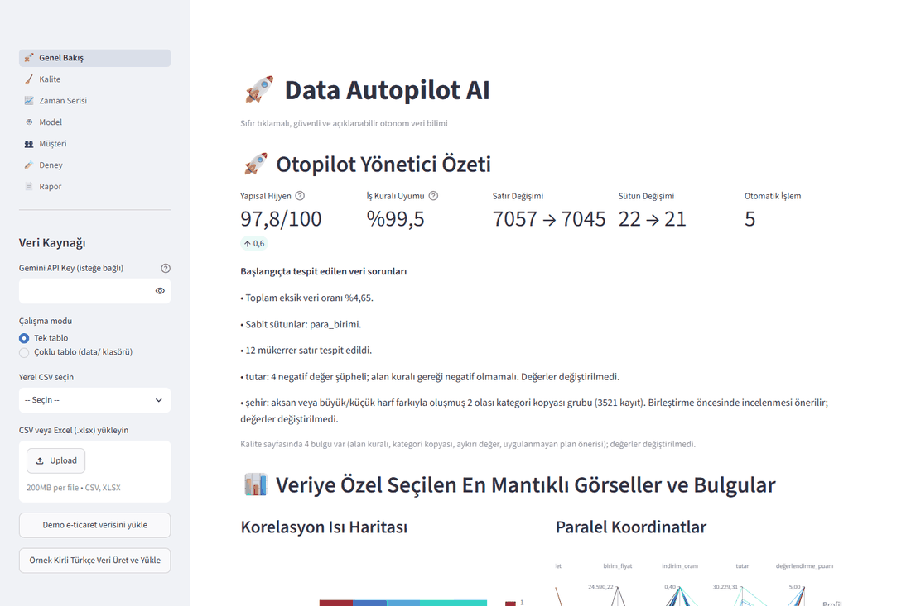

# 🚀 Data Autopilot AI

[](https://github.com/arda-can/data-autopilot-ai/actions/workflows/ci.yml)

Bir CSV veya Excel dosyası verin. Uygulama veriyi temizler, kalitesini iş kurallarına karşı ölçer, müşterileri segmentlere ayırır, bir metriğin neden değiştiğini bulur, A/B testini değerlendirir, sızıntıya karşı korunan bir model eğitir ve hepsini Türkçe bir yönetici raporunda toplar. Her adım deterministik, kayıt altında ve KVKK'ya duyarlı. LLM yalnızca plan önerir, kod çalıştırmaz.



## Bir dakikada demo

```bash
pip install -r requirements.txt
streamlit run app.py
```

Tarayıcıda **http://localhost:8501/?demo=1** adresini açın. Uygulama, sentetik e-ticaret verisiyle (7.057 sipariş, 4.000 müşteri) hazır gelir. Aynı veri kenar çubuğundaki "Demo e-ticaret verisini yükle" düğmesiyle de yüklenebilir. Demo verideki her örüntü bilerek konmuştur ve [`core/demo_data.py`](core/demo_data.py) içinde belgelenmiştir; uygulamanın bulduğunu söylediği her şey doğrulanabilir.

| Sayfa | Ne görürsünüz | Demo veride ne bulunur |
|---|---|---|
| **Genel Bakış** | Yönetici özeti, otomatik seçilen grafikler, Türkçe soru-cevap (eşdeğer pandas ve SQL ile) | 12 mükerrer satır, sabit sütun, negatif tutarlar, şehir yazım farkları |
| **Kalite** | *Yapısal hijyen* ve *iş kuralı uyumu* ayrı skorlar; veriden önerilen kurallar, kural ekleme, ihlal eden kayıtları indirme | 12 önerilen kural, bilerek konmuş ihlallerin hepsini doğru sayıyla yakalar (uyum %99,5) |
| **Zaman Serisi** | Trend, mevsimsellik, tahmin; iki dönem karşılaştırması; **"Neden değişti?"** katkı ayrıştırması | Q4 2025'teki puan düşüşünün %105'i Ankara'dan (eşit yayılsaydı %14,5 beklenirdi) |
| **Model** | Çapraz doğrulamayla model seçimi, taban model kıyası, **hedef sızıntısı uyarısı**, kısmi bağımlılık, what-if | `sipariş_durumu` hedefinde teslim tarihinin sızıntı olduğunu söyler; `iade_edildi` sızıntısız öğrenilir |
| **Müşteri** | RFM segmentleri ve aksiyon önerileri, kohort tutundurma ısı haritası, 3/6/12 aylık tarihsel müşteri değeri | %40,7 tekrar eden müşteri; "Kaybedilmemeli" segmenti gelirin %10'u |
| **Deney** | A/B testi: z-testi ya da Welch, güven aralığı, SRM alarmı, güç ve gereken örneklem | Müşteri düzeyinde B grubu +%34 ek ürün oranı (p = 0,007), SRM temiz |
| **Rapor** | Diğer sayfalardaki seçimlerle tek tıkla HTML (etkileşimli) ve PDF yönetici raporu | Ham satır ve müşteri kimliği içermez |

Ekran görüntüleri: [`docs/ekranlar/`](docs/ekranlar/).

## Neyi farklı yapıyor

**Güvenlik ve dürüstlük**

- **LLM kod çalıştırmaz, yalnızca plan yapar.** Gemini, Pydantic şemasıyla doğrulanan bir JSON döndürür (temizlik planı ya da veri kuralı). Dönüşümleri önceden yazılmış güvenli fonksiyonlar uygular. Kod tabanında `exec`/`eval` yoktur.
- **Kişisel veri LLM'e gitmez.** Ham satır gönderilmez. E-posta, telefon, TC kimlik, IBAN ve kart numarası maskelenir; hassas sütunların örnekleri ve istatistikleri tümüyle gizlenir.
- **Veri sızıntısı yok.** Eksik doldurma ve ölçekleme yalnızca eğitim bölmesinden öğrenilir. Temizlenmiş veride eksikler ve aykırı değerler uydurulmaz, yalnızca raporlanır.
- **Metrik parlatılmaz.** Taban modeli geçemeyen model "tahmin edilemiyor" diye bildirilir. Kural tanımlanmamışsa uyum skoru gösterilmez. Gözlenmemiş kohort hücreleri boş kalır, 0 sayılmaz. SRM alarmında A/B sonucu yorumlanmaz.
- **Her değişiklik kayıtlı.** Hangi sütuna ne yapıldığı ve kaç satırın etkilendiği audit log'da görünür.

**Analiz**

- **İş kuralları.** Aralık, benzersiz, boş olamaz, izinli değerler, desen, iki sütun karşılaştırması. Kurallar serbest ifade değil sınırlı tiplerdir. Veriden gerekçeli öneri olarak gelir, elle eklenir ya da JSON'dan yüklenir.
- **Neden değişti?** Sayım, toplam, ortalama ya da oranın iki dönem arasındaki değişimi boyut değerlerinin katkılarına tam olarak ayrıştırılır; katkıların toplamı değişime eşittir. Ortalamalarda karma etkisi ile grup içi değişim ayrı gösterilir. Boyutlar "değişim eşit yayılsaydı" beklentisinden sapmaya göre sıralanır.
- **Müşteri analizi.** RFM (eşit değerler aynı skoru alır), kohort tutundurma ve edinimden sonraki N ayı tamamen gözlenmiş müşterilerle tarihsel değer; tanımlar ekranda yazılı.
- **A/B testi.** Atama müşteri bazındaysa analiz müşteri düzeyinde yapılır; aynı müşterinin siparişleri bağımsız sayılmaz. Anlamsız sonuçta yakalanabilir en küçük fark ve gereken örneklem söylenir. İstatistikler testlerde statsmodels ile çapraz doğrulanır.
- **AutoML.** Çapraz doğrulamayla seçim, seçime katılmayan test bölmesi, zamana göre bölme, "tahmin anı" ayarları, sızıntı uyarısı, kısmi bağımlılık ve what-if.
- **Zaman serisi ve dönem karşılaştırması.** Trend, haftalık/yıllık döngü, olağan dışı dönemler ve aralıklı tahmin (naif tahmine karşı geriye dönük test); iki dönem ya da iki dosya arasında PSI ile trafik ışığı.
- **Çoklu tablo.** `data/` içindeki tabloların ortak anahtarları bulunur; satır sayısını koruyan, onaylı bir planla tek tabloya getirilir.
- **Şeffaf sohbet.** "İstanbul için 2018'de aylık harcama" gibi koşullu sorular; her cevabın altında eşdeğer pandas ve SQL.
- **API anahtarı olmadan da çalışır.** Anahtar yoksa kurallı yerel planlayıcı devreye girer.

## Kurulum

Python 3.13 ile geliştirildi (en az 3.11 gerekir).

```bash
python -m venv .venv
.venv\Scripts\activate          # macOS/Linux: source .venv/bin/activate
pip install -r requirements.txt
streamlit run app.py
```

Gemini API anahtarı isteğe bağlıdır ve kenar çubuğundan girilir; hiçbir yere kaydedilmez.

## Veri

Depoda iki sentetik veri seti var; ikisi de gerçek kişi verisi içermez:

- **`data/demo_eticaret_siparisleri.csv`**: 2024–2025 arası 7.057 sipariş, 4.000 müşteri. Bilerek konmuş örüntüler: tekrar eden müşteriler; gecikmeye, kategoriye ve indirime bağlı iade ve puan; 2025'in ikinci yarısında mobil kanala kayma; Ekim 2025'ten itibaren Ankara'da teslimat gecikmesi; Temmuz 2025'te başlayan müşteri bazlı A/B deneyi. Sayısı kayıtlı kural ihlalleri de vardır: negatif tutar, 1'den büyük indirim oranı, siparişten önce teslim, 1–5 dışı puan, geçersiz e-posta, şehir yazım farkı, tekrarlanan sipariş numarası, mükerrer satır. Ad, e-posta ve telefon sütunları KVKK maskesini göstermek içindir.
- **`data/kirli_musteri_verisi.csv`** ("Örnek Kirli Türkçe Veri Üret ve Yükle"): biçim temizliğini gösteren 200 satırlık küçük örnek.

Daha büyük bir deneme için [Olist Brazilian E-Commerce](https://www.kaggle.com/datasets/olistbr/brazilian-ecommerce) veri setini indirip CSV dosyalarını `data/` klasörüne koyun; uygulama onları otomatik listeler. Bu dosyalar boyutları nedeniyle depoya dahil değildir.

## Streamlit Community Cloud'a yayınlama

1. Depo GitHub'da olmalı. [share.streamlit.io](https://share.streamlit.io) → **Create app** → depo `arda-can/data-autopilot-ai`, dal `main`, ana dosya `app.py`.
2. **Advanced settings** → Python sürümü **3.13**. Secrets gerekmez: Gemini anahtarı ziyaretçinin kendi anahtarıdır ve yalnızca oturumda kalır.
3. Bağımlılıklar `requirements.txt` dosyasından kurulur; tema ve araç çubuğu `.streamlit/config.toml` dosyasındadır.
4. Paylaşılacak bağlantı: `https://<uygulama-adı>.streamlit.app/?demo=1`. Bu bağlantı demo veriyle açılır. Otopilot sonucu sunucudaki dosyalar için oturumlar arasında önbelleğe alınır; ilk ziyaretçiden sonra açılış anında olur.

Cloud'da Chrome kurulu olmadığı için PDF rapordaki grafikler Kaleido yerine Matplotlib yedeğiyle çizilir; PDF bunu not olarak belirtir. HTML rapor etkilenmez.

## Testler

```bash
pip install -r requirements-dev.txt
pytest
```

381 test; bunların 14'ü Streamlit AppTest ile uçtan uca arayüz testidir. Testler sentetik veriyle çalışır ve API anahtarı kullanmaz: Gemini yolları sahte SDK yanıtlarıyla sınanır.

README'deki GIF ve ekran görüntüleri `scripts/demo_capture.py` ile yeniden üretilir: yerel sunucuyu başlatır, Chrome'u başsız açıp demo akışını gezer.

## Sınırlamalar

- Gemini yolu gerçek bir anahtarla uçtan uca doğrulanmadı; testler sahte SDK yanıtı kullanır.
- "Neden değişti?" bir muhasebe ayrıştırmasıdır, nedensellik kanıtı değildir; boyutlar ayrı ayrı incelenir.
- Müşteri değeri tarihseldir ve gelir bazlıdır (kâr marjı yok); tahmin modeli değildir.
- AutoML tek tabloda en fazla 10.000 satırlık örneklemle eğitilir; rapor bunu belirtir.
- Leaderboard metrik adları (`R2 Score`, `Accuracy`) ve Streamlit'in dosya yükleme düğmesi İngilizcedir.

## Mimari

```
app.py               Streamlit giriş noktası: veri kaynağı, ?demo=1, sayfa gezintisi
views/               Sayfalar: Genel Bakış, Kalite, Zaman Serisi, Model, Müşteri, Deney, Rapor (yalnızca sunum)
core/ingestion.py    Dosya okuma, encoding ve ayraç tespiti
core/columns.py      Sütun tipi çıkarımı: metin, sayı, tarih, kimlik
core/health.py       Yapısal hijyen skoru ve aykırı değer raporu
core/rules.py        Veri kuralları ve iş kuralı uyumu
core/customers.py    RFM, kohort tutundurma, tarihsel müşteri değeri
core/rootcause.py    "Neden değişti?" katkı ayrıştırması
core/experiment.py   A/B testi, SRM, güç ve örneklem
core/demo_data.py    Sentetik demo veri seti ve belgelenmiş örüntüleri
core/metadata.py     PII maskeli metadata kartı
core/planner.py      Gemini planlayıcı + kurallı fallback
core/executor.py     Deterministik dönüşümler ve audit log
core/autopilot.py    Orkestrasyon, grafik seçimi, hedef önerisi
core/automl.py       Sızıntısız model karşılaştırması
core/chat.py         Doğal dil sorusu → yapılandırılmış sorgu (+ pandas/SQL karşılığı)
core/timeseries.py   Zaman serisi: trend, mevsimsellik, anomali, tahmin
core/drift.py        Dönem karşılaştırması: şema, eksik oranı, PSI
core/relations.py    Çoklu tablo: anahtar keşfi ve güvenli birleştirme
core/explain.py      Kısmi bağımlılık ve what-if
core/report.py       Yönetici raporu: HTML ve PDF
```

Ayrıntılı analiz, bilinen sorunlar ve yol haritası: [ANALIZ.md](ANALIZ.md). Demo videosu çekim senaryosu: [docs/VIDEO_SENARYOSU.md](docs/VIDEO_SENARYOSU.md).
